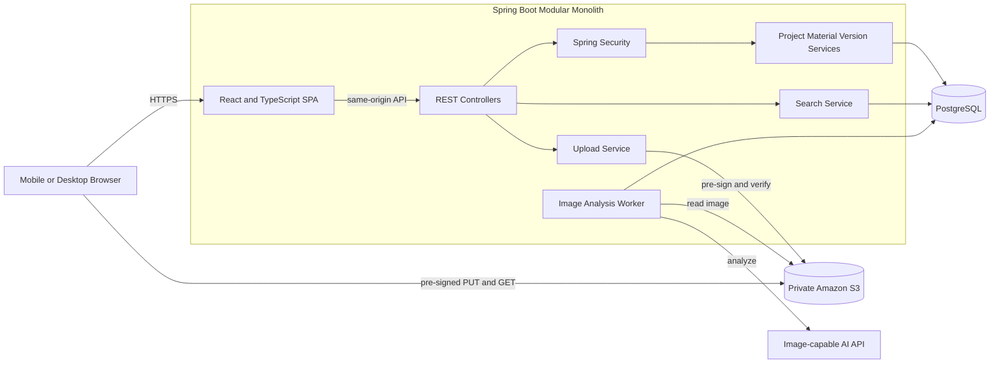
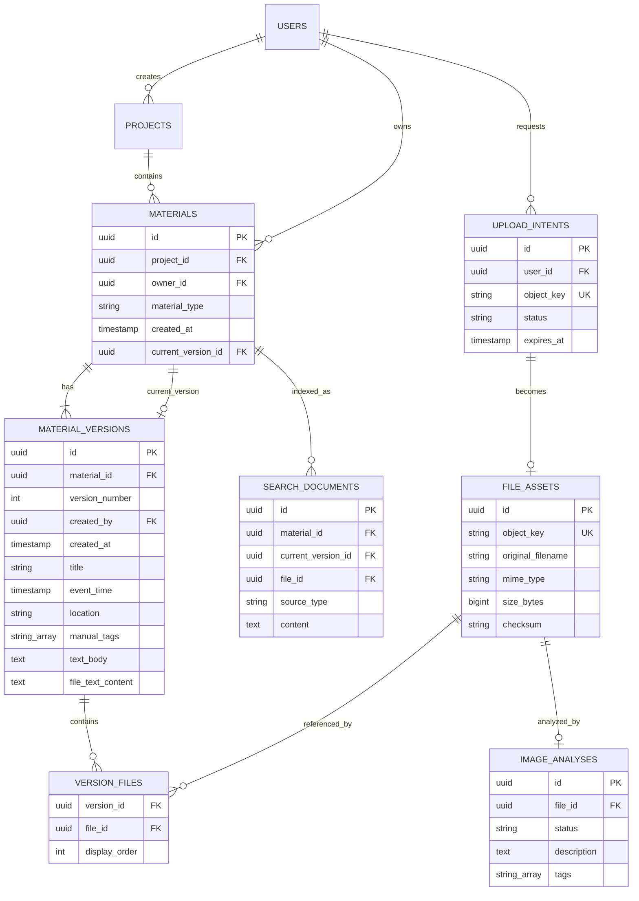
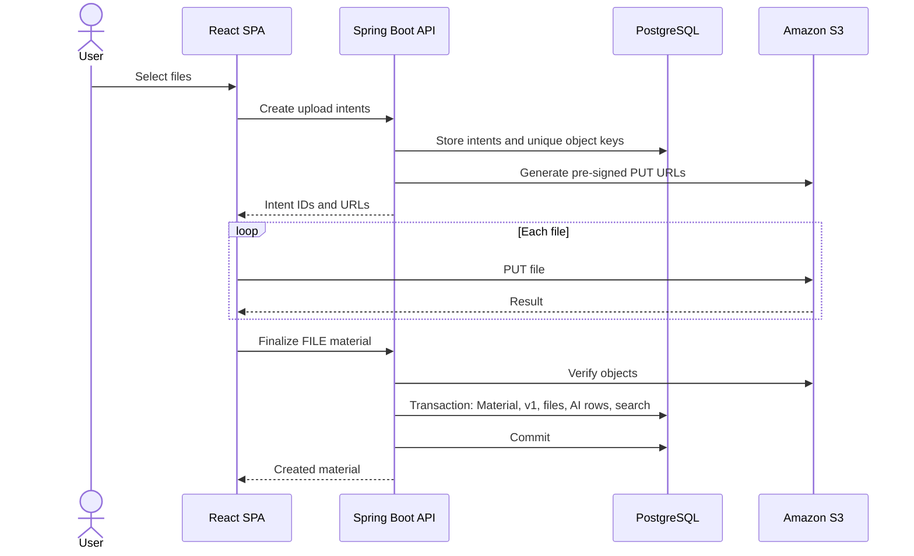
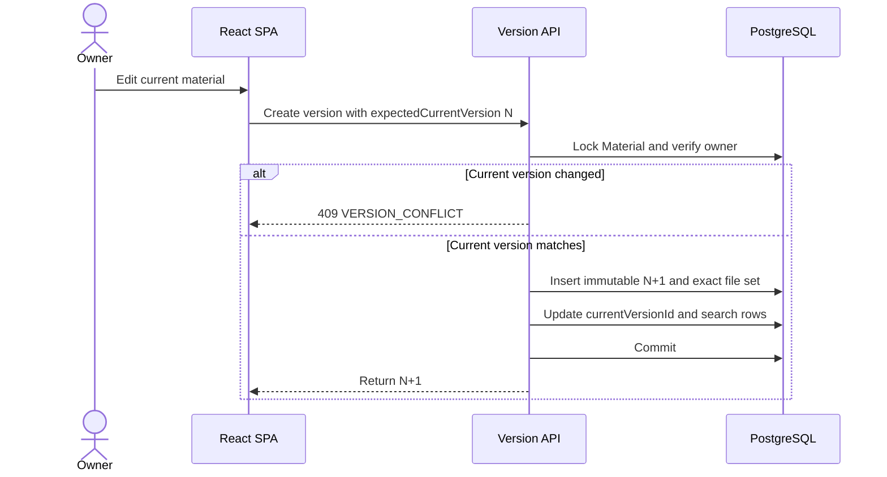

# Adopt a Spring Boot, PostgreSQL, and S3 Architecture for the Internal News Material System

| Field | Value |
|---|---|
| Status | Draft — ready with named open decisions |
| Author / DRI | [owner needed] |
| Decision owner | [owner needed] |
| Reviewers | Mentor; additional reviewers [owner needed] |
| Last updated | 2026-08-22 |
| Decision deadline | Before implementation begins [date needed] |

## 1. Executive Summary

This document proposes a responsive internal web application for organizing news materials by reporting project. The selected architecture follows the mentor-discussed direction: React and TypeScript for the web UI, Spring Boot for the backend, PostgreSQL for metadata/version/search state, private Amazon S3 for file bytes, and an image-capable AI API for per-image descriptions and tags.

Each material has one owner and an immutable linear history. All authenticated users may view materials, files, and historical versions, while only the owner may create a new version. File bytes upload directly from the browser to S3 through pre-signed URLs. AI analysis runs after material creation and cannot block or invalidate the primary upload flow.

Reviewers are asked to approve this architecture and resolve the open decisions before their dependent implementation begins.

## 2. Background and Scope

Multiple journalists may independently contribute photographs, video, audio, documents, or written observations to one event such as `City Flood`. The system groups those independently owned materials under one reporting project and supports upload, management, search, download, and modification history.

The user-provided constraint is a happy-path demo within one week and the agreed implementation within two weeks using AI-assisted development. The design keeps direct S3 upload, multi-file materials, linear version history, current-version search, and image AI enrichment. Native apps, media editing, complex roles, team notifications, Kafka, collaborative editing, branches, merges, semantic vector search, and hard deletion are excluded.

## 3. Goals and Acceptance Criteria

### Goals

- Organize TEXT and FILE materials under shared reporting projects.
- Let every authenticated user view all materials and add independently owned materials.
- Support mobile and desktop browser upload, viewing, download, and search.
- Preserve immutable, owner-only, full-snapshot versions.
- Search only each material's current version.
- Associate AI metadata with the exact image FileAsset that produced it.
- Keep AI failure separate from material creation.

### Acceptance Criteria

| Outcome | Acceptance condition |
|---|---|
| TEXT flow | User creates, reopens, searches, and versions a valid TEXT material |
| FILE flow | User uploads multiple files directly to S3 and reopens the FILE material |
| Ownership | Automated tests show zero successful non-owner writes |
| History | Creating N+1 leaves N and its file set unchanged |
| Search | Current text matches; text existing only in history does not |
| AI isolation | Material remains usable when image analysis fails |
| Mobile | Upload succeeds in a supported real mobile browser |
| Delivery | Demo within one week; agreed scope within two weeks |

## 4. Requirements and Constraints

### Functional Requirements

1. Every request except login and static assets requires authentication.
2. All authenticated users can view projects, materials, files, and histories.
3. All authenticated users can add a new independently owned material to an existing project.
4. Only a material owner can create its next version.
5. Material type is permanently `TEXT` or `FILE`.
6. TEXT requires a non-empty text body and has no files.
7. FILE requires at least one file and may contain user-authored text.
8. Current and historical versions use the same layout; history is labeled and read-only.
9. Search returns one result per material and considers only the current version.
10. Each image has its own AI status, description, and tag list.
11. AI processing starts after the material transaction commits.
12. File download requires authorization and a pre-signed GET URL.

### Non-functional Requirements

- Version rows and version-file associations are immutable.
- A version becomes current only after one complete database transaction.
- S3 stores bytes; PostgreSQL stores authoritative metadata.
- The bucket is private and authorization is checked server-side.
- Upload, version, AI, and search workflows expose structured status and logs.
- The application is a modular monolith without Kafka or microservices.

### Assumptions and Evidence Gaps

| Item | Type | Validation | Due |
|---|---|---|---|
| One Spring Boot instance is enough for the demo | Assumption | Test expected concurrency | Before deployment |
| File-count and file-size limits are unknown | Evidence gap | Approve limits and test boundaries | Before upload API |
| All authenticated users may create projects | Working assumption | Confirm with mentor | Before project API |
| Project creator may rename; no deletion | Working assumption | Confirm with mentor | Before project API |
| AI is generated once and not editable | Working assumption | Confirm AI lifecycle | Before AI work |
| Search language behavior is unknown | Evidence gap | Test representative queries | Before search sign-off |

## 5. Architecture Decision

| Criterion | React + Spring Boot | Next.js full-stack | React + FastAPI |
|---|---|---|---|
| Mentor alignment | Strong | Weak | Weak |
| Demo effort | Medium | Lowest | Medium |
| Transaction boundaries | Strong | Adequate | Strong |
| S3/PostgreSQL support | Strong | Strong | Strong |
| Selected | **Yes** | No | No |

Vite builds the React SPA. Spring Boot serves the static build and `/api/v1` from one origin, avoiding CORS and cross-site-session complexity. Spring Boot 4.1.x is a current stable line; lock the patch version at implementation kickoff. [Spring Boot](https://spring.io/projects/spring-boot/)



The browser moves file bytes directly to S3. Spring Boot remains authoritative for authentication, permissions, metadata, version transactions, search, and AI-job state.

## 6. Components and Authorization

| Component | Responsibility |
|---|---|
| React SPA | Responsive forms, upload progress, search, material/version rendering |
| Spring Security | Login, HTTP session, CSRF, authenticated principal |
| Project Service | Project list/create/approved rename behavior |
| Material Service | Create material and read current aggregate |
| Version Service | Create immutable next version and enforce ownership |
| Upload Service | Upload intents, pre-signing, S3 verification, orphan cleanup |
| Search Service | Current-version text/filter queries |
| Analysis Worker | Persistent AI processing and retries |
| PostgreSQL | Metadata, versions, job state, search documents |
| S3 | Private immutable file objects |

Use Spring Security username/password authentication with an HTTP session. [Authentication](https://docs.spring.io/spring-security/reference/servlet/authentication/index.html) [Session management](https://docs.spring.io/spring-security/reference/servlet/authentication/session-management.html)

| Action | Rule |
|---|---|
| View projects/materials/files/history | Any authenticated user |
| Create project | Any authenticated user, pending confirmation |
| Rename project | Creator, pending confirmation |
| Create material | Any authenticated user; caller becomes owner |
| Create version | Material owner only |
| Request download URL | Any authenticated user |
| Retry AI analysis | Material owner only |
| Hard delete | No initial endpoint |

Backend authorization is mandatory even if the UI hides an action. Session cookies use `HttpOnly`, `Secure`, and `SameSite=Lax`; state-changing requests retain CSRF protection.

## 7. Logical Domain Model

```text
Material {
  materialId,
  reportingProjectId,
  ownerId,
  materialType,
  materialCreatedTime,
  currentVersionId
}

Version {
  versionId,
  materialId,
  versionNumber,
  versionCreatedTime,
  versionCreator,
  snapshot
}

VersionSnapshot {
  title,
  eventTime,
  location,
  manualTags,
  content
}

TextVersionContent { textBody }

FileVersionContent {
  textContent,
  files
}

FileAsset {
  fileId,
  uploaderId,
  objectKey,
  originalFilename,
  fileType,
  fileSize,
  checksum,
  fileCreatedTime,
  imageAnalysis
}

ImageAnalysis {
  analysisId,
  fileId,
  status,
  aiDescription,
  aiTags,
  generatedTime,
  attemptCount,
  nextAttemptTime
}
```

Stable Material fields are ID, project, owner, type, and creation time. Title, optional metadata, tags, text, file set, and file order belong to VersionSnapshot. FileAsset is immutable; replacing a file creates a new FileAsset and S3 object. ImageAnalysis belongs to one image FileAsset, is absent for non-images, is generated once, and does not create a material version.

## 8. Relational Data Model



Key invariants are unique `(material_id, version_number)`, unique `(version_id, file_id)`, unique S3 keys, immutable versions/files, and transactional current-version updates. `VERSION_FILES` allows unchanged files to be reused across versions without duplicating S3 bytes.

## 9. Direct File Upload



No material becomes visible until all required files exist, verification passes, and the transaction commits. S3 pre-signed URLs provide temporary access without exposing credentials. Because S3 replaces uploads to an existing key, each upload uses a new random key. [S3 documentation](https://docs.aws.amazon.com/AmazonS3/latest/userguide/using-presigned-url.html)

UploadIntent stores the user, object key, expected filename/type/size/checksum, status, and expiry. Cleanup requires an expired unattached intent and no FileAsset reference.

## 10. Version Creation



`expectedCurrentVersion` prevents two tabs from silently overwriting each other. `Idempotency-Key` prevents duplicate materials or versions after network retries.

## 11. Image Analysis and Search

A committed image FileAsset receives a `PENDING` ImageAnalysis row. A scheduled worker claims pending rows, reads the private image from S3, calls the AI provider, validates structured JSON, and changes the status to `COMPLETED`. Provider failure schedules retry; exhausted retries produce `FAILED`. The material remains usable in every state. **Proposed target:** three automatic attempts before owner-controlled retry.

The OpenAI Responses API supports image input analysis. [OpenAI Images and Vision](https://developers.openai.com/api/docs/guides/images-vision)

Search indexes only current versions. Material-level rows contain title, text body or file text, manual tags, and location. File-level rows contain AI description and AI tags. Each row stores material ID, current version ID, optional file ID, source type, and content. Queries join against `Material.currentVersionId`, preventing stale historical matches. AI matches return `matchedFileId` so the UI can highlight the image.

Filters include project, material type, owner, created-time range, event-time range, location, and manual tags. PostgreSQL `pg_trgm` supports similarity and indexed `LIKE`/`ILIKE`. [PostgreSQL pg_trgm](https://www.postgresql.org/docs/17/pgtrgm.html)

## 12. Frontend and API

Pages include login, project list/detail, new material, current material, owner edit, version timeline, and historical version. Current and historical views share `MaterialSnapshotView`; historical mode adds a read-only banner and disables editing. TEXT and FILE use type-specific content renderers.

Core `/api/v1` endpoints:

| Method/path | Purpose | Access |
|---|---|---|
| `POST /auth/login` | Start session | Public |
| `GET/POST /projects` | List/create projects | Authenticated |
| `GET /projects/{id}/materials` | Current search and filters | Authenticated |
| `POST /uploads/intents` | Create upload URLs | Authenticated |
| `POST /materials/text` | Create TEXT and v1 | Authenticated |
| `POST /materials/file` | Create FILE and v1 | Authenticated |
| `GET /materials/{id}` | Current version | Authenticated |
| `POST /materials/{id}/versions` | Create next version | Owner |
| `GET /materials/{id}/versions` | Version list | Authenticated |
| `GET /materials/{id}/versions/{n}` | Historical snapshot | Authenticated |
| `POST /files/{id}/download-url` | Authorized download | Authenticated |
| `POST /files/{id}/analysis/retry` | Retry AI | Owner |

No DELETE endpoint exists initially. Expected errors include `401`, `403`, `404`, `409`, `413`, `415`, `422`, `502`, and `503`, returned in a stable JSON envelope with `code`, `message`, `requestId`, and `details`.

## 13. Reliability, Security, and Observability

| Failure | Behavior |
|---|---|
| One file upload fails | Retry that upload; do not create partial material |
| Finalize never occurs | Keep expired unattached intent for safe cleanup |
| S3 metadata/checksum mismatch | Reject finalization and re-upload |
| DB commit fails after upload | Keep intent retryable; material remains absent |
| Concurrent owner edits | Return `409 VERSION_CONFLICT` |
| AI timeout/malformed output | Persist retry/failed state; material remains usable |
| Stale search rows | Current-version join excludes them; reconciliation rebuilds |
| PostgreSQL or S3 unavailable | Fail safely without mutating version state |

Security requirements include HTTPS, adaptive password hashing, HttpOnly/Secure session cookies, CSRF protection, private S3, least-privilege IAM, authorization before pre-signing, random immutable object keys, size/type/checksum validation, secret management, and exclusion of signed URLs or content from logs. Real newsroom images require AI-provider privacy approval; use synthetic images until approved. Malware scanning is outside the two-week scope, so the system is not production-ready for untrusted public uploads.

Structured logs and Actuator metrics track request IDs, users, materials, versions, uploads, analyses, HTTP failures, version conflicts, AI backlog, search failures, DB pool use, and dependency errors. Logs never contain content bodies, file bytes, credentials, sessions, or signed URLs.

## 14. Testing and Rollout

Unit tests cover type invariants, authorization, snapshots, search-document construction, and AI state transitions. PostgreSQL integration tests cover atomic v1 creation, immutable N+1 creation, concurrent conflict, permissions, current-only search, and idempotency. S3 adapter tests cover pre-signing, object verification, partial upload, and cleanup. End-to-end tests cover login, TEXT/FILE creation, multi-file mobile upload, current/history layouts, owner/non-owner permissions, download, search, AI completion, and AI failure.

Rollout phases:

1. Resolve schema- and permission-changing decisions.
2. Build login plus TEXT vertical slice.
3. Add S3 multi-file upload and download.
4. Add immutable version creation and history.
5. Add current-only search.
6. Add durable AI worker and retry.
7. Verify mobile flow, security, logs, tests, and hosted rollback.

Migrations remain expand-only during development. Initial scope contains no irreversible material, version, or S3 deletion.

## 15. Risks and Open Decisions

| Risk/decision | Recommendation | Due |
|---|---|---|
| Spring Boot plus React exceeds demo budget | Build one thin vertical slice first | Immediately |
| Project create/rename permissions | All create; creator renames; no delete | Before project API |
| File count/size/MIME limits | Approve explicit demo limits | Before upload API |
| Upload cleanup delay | Configurable delay after expiry | Before cleanup worker |
| AI provider/privacy | OpenAI with synthetic demo images until approved | Before AI work |
| AI retry and re-analysis | Three retries; no re-analysis initially | Before AI worker |
| Material/version deletion | No delete initially | Before retention work |
| Search language quality | Substring plus trigram; validate real queries | Before search sign-off |
| Malware risk | Restrict demo users and formats | Before external use |
| Deployment/PostgreSQL provider | Decide after local vertical slice; retain portability | Before hosted demo |

## 16. Decision Log and Review Verdict

| Decision | Rationale |
|---|---|
| FILE and TEXT are the only material types | Keeps field rules explicit |
| Owner-only linear version history | Traceability without merge complexity |
| Complete read-only historical snapshots | Consistent audit and UI behavior |
| Current-version-only global search | Avoids duplicate and obsolete results |
| ImageAnalysis belongs to image FileAsset | Preserves per-image association |
| React + Spring Boot + PostgreSQL + S3 | Aligns with mentor architecture |
| No Kafka | No initial workflow justifies a broker |

**Review verdict: Ready with named open decisions.** Architecture, ownership, version invariants, upload flow, search boundary, AI isolation, security, testing, and rollout are coherent. Project permissions, file limits, AI/privacy rules, search-language validation, and hosting must be resolved at their named gates.

