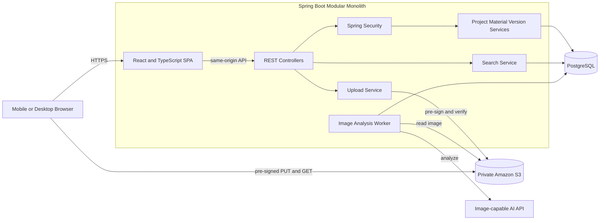
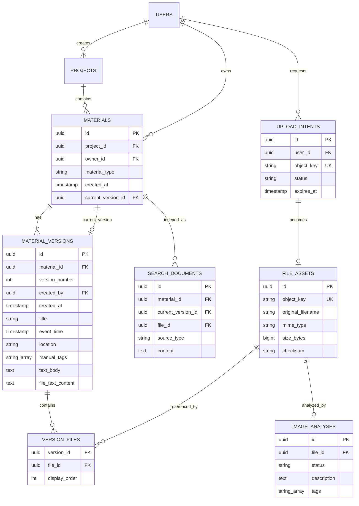
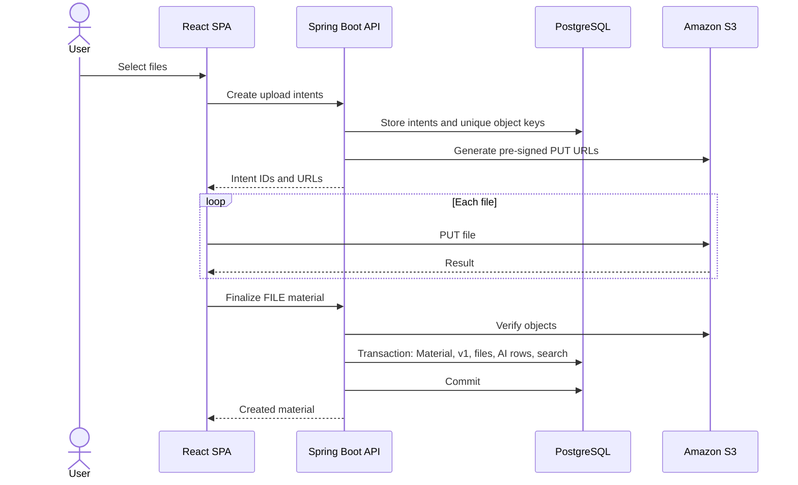
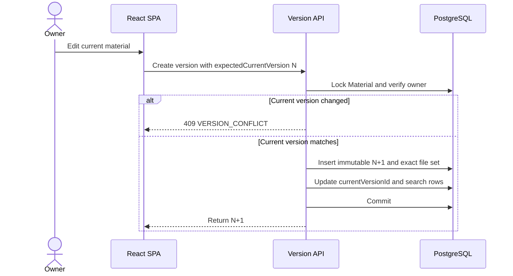

# News Material Management System - Design Document

| Field | Value |
|---|---|
| Status | Final |
| Owner | Emma Liu |
| Mentor | ABX |
| Last updated | 2026-08-29 |

## 1. Executive Summary

The News Material Management System is a responsive internal newsroom web application used through desktop and mobile browsers; it is not a native mobile application. It groups independently owned text notes, photographs, audio, video, and documents under reporting projects that represent news events.

Authenticated users can create projects, add their own materials, browse current materials, search across projects, download files, and inspect complete version histories. A material owner can publish a new immutable version, while other users can view or download that material and contribute separate materials to the same project. Search covers current versions only, and per-image analysis adds searchable descriptions and tags without blocking material creation.

Projects, materials, and versions cannot be deleted through the product. This boundary preserves traceability and keeps the ownership and version model intentionally simple.

## 2. Background and Current State

A single reporting event can produce evidence from several people and devices: written observations, photographs, recordings, video clips, and supporting documents. Without a shared structure, those items are difficult to discover, compare, and trace as they change.

A reporting project is the shared event container. Each material inside it remains independently owned, records its creator and creation time, and exposes a complete linear history. Users can browse a project's current materials directly or use the global search page to find current material across all projects.

The application must keep original and historical information inspectable while allowing a material owner to publish corrected or expanded snapshots. AI-generated image metadata is supplemental search information and never replaces user-authored content or source files.

## 3. Goals and Non-Goals

### Goals

- Organize TEXT and FILE materials under reporting projects.
- Let authenticated users browse all current materials and add independently owned materials.
- Provide one responsive browser experience for desktop and mobile use.
- Preserve immutable, owner-controlled, full-snapshot version histories.
- Search current versions across all projects with focused filters and relevance ranking.
- Associate AI descriptions and tags with the exact image that produced them.
- Keep upload, versioning, search, and AI failure states understandable to users.

### Non-Goals

- A native iOS or Android application.
- In-product photo, audio, video, or document editing.
- Anonymous or public access.
- Collaborative co-editing, branches, merges, or multiple owners for one material.
- Tracking provenance after a user downloads a file and creates a separate material from it.
- Deleting projects, materials, or versions through the application.

## 4. Requirements and Constraints

### Functional Requirements

1. Every request except login and static assets requires authentication.
2. All authenticated users can view projects, materials, files, and histories.
3. All authenticated users can add a new independently owned material to an existing project.
4. Only a material owner can create its next version.
5. Material type is permanently `TEXT` or `FILE`.
6. TEXT requires a non-empty text body and has no files.
7. FILE requires at least one file and may contain user-authored text.
8. Current and historical versions use the same layout; history is labeled and read-only.
9. Project detail displays the current version of every material in that project without requiring a search.
10. Global search returns one result per material and considers only the current version.
11. Global keyword input accepts comma-separated terms, uses case-insensitive substring OR matching, and ranks by the count of distinct matched terms.
12. Global filters are limited to event-time range, location, and file category (`All`, `Text`, `Image`, `Video`, `Audio`, or `Other file`).
13. Each image has its own AI status, description, and tag list.
14. AI processing starts after the material transaction commits.
15. File download requires authorization and a pre-signed GET URL.

### Non-functional Requirements

- Version rows and version-file associations are immutable.
- A version becomes current only after one complete database transaction.
- S3 stores bytes; PostgreSQL stores authoritative metadata.
- The bucket is private and authorization is checked server-side.
- Upload, version, AI, and search workflows expose structured status and logs.
- The application is a modular monolith without Kafka or microservices.

### Fixed Product and Implementation Constraints

| Area | Final rule |
|---|---|
| Application shape | One same-origin responsive web application backed by a modular monolith |
| Access | Authenticated internal users only |
| Project permissions | Any authenticated user can create a project; only its creator can rename it |
| Deletion | No project, material, or version deletion is exposed |
| Upload limits | One server policy exposed by `/capabilities`; defaults are 10 files, 50 MiB each, and 200 MiB total |
| AI lifecycle | Analysis is per image, asynchronous, and supplemental; failure cannot invalidate a material |
| Search language | Comma-separated OR terms, case-insensitive substring matching, no typo correction |

## 5. Architecture Decision

| Criterion | React + Spring Boot | Next.js full-stack | React + FastAPI |
|---|---|---|---|
| Fit with the implemented codebase | Strong | Requires a rewrite | Requires a rewrite |
| Transaction boundaries | Strong | Adequate | Strong |
| S3 and PostgreSQL integration | Strong | Strong | Strong |
| Same-origin deployment | Straightforward | Straightforward | Requires separate integration |
| Selected | **Yes** | No | No |

Vite builds the React SPA. Spring Boot serves the static build and `/api/v1` from one origin, avoiding CORS and cross-site-session complexity. The implementation pins its framework and dependency versions in the repository.



The browser moves file bytes directly to S3. Spring Boot remains authoritative for authentication, permissions, metadata, version transactions, search, and AI-job state.

## 6. Components and Authorization

| Component | Responsibility |
|---|---|
| React SPA | Responsive forms, upload progress, search, material/version rendering |
| Spring Security | Login, HTTP session, CSRF, authenticated principal |
| Project Service | Project list/create/approved rename behavior |
| Material Service | Create material and read current aggregate |
| Version Service | Create immutable next version and enforce ownership |
| Upload Service | Upload intents, pre-signing, S3 verification, orphan cleanup |
| Search Service | Current-version text/filter queries |
| Analysis Worker | Persistent AI processing and retries |
| PostgreSQL | Metadata, versions, job state, search documents |
| S3 | Private immutable file objects |

Use Spring Security username/password authentication with an HTTP session. [Authentication](https://docs.spring.io/spring-security/reference/servlet/authentication/index.html) [Session management](https://docs.spring.io/spring-security/reference/servlet/authentication/session-management.html)

| Action | Rule |
|---|---|
| View projects/materials/files/history | Any authenticated user |
| Create project | Any authenticated user |
| Rename project | Project creator only |
| Create material | Any authenticated user; caller becomes owner |
| Create version | Material owner only |
| Request download URL | Any authenticated user |
| Retry AI analysis | Material owner only |
| Delete project, material, or version | Not supported |

Backend authorization is mandatory even if the UI hides an action. Session cookies use `HttpOnly`, `Secure`, and `SameSite=Lax`; state-changing requests retain CSRF protection.

## 7. Logical Domain Model

```text
Material {
  materialId,
  reportingProjectId,
  ownerId,
  materialType,
  materialCreatedTime,
  currentVersionId
}

Version {
  versionId,
  materialId,
  versionNumber,
  versionCreatedTime,
  versionCreator,
  snapshot
}

VersionSnapshot {
  title,
  eventTime,
  location,
  manualTags,
  content
}

TextVersionContent { textBody }

FileVersionContent {
  textContent,
  files
}

FileAsset {
  fileId,
  uploaderId,
  objectKey,
  originalFilename,
  fileType,
  fileSize,
  checksum,
  fileCreatedTime,
  imageAnalysis
}

ImageAnalysis {
  analysisId,
  fileId,
  status,
  aiDescription,
  aiTags,
  generatedTime,
  attemptCount,
  nextAttemptTime
}
```

Stable Material fields are ID, project, owner, type, and creation time. Title, optional metadata, tags, text, file set, and file order belong to VersionSnapshot. FileAsset is immutable; replacing a file creates a new FileAsset and S3 object. ImageAnalysis belongs to one image FileAsset, is absent for non-images, is generated once, and does not create a material version.

## 8. Relational Data Model



Key invariants are unique `(material_id, version_number)`, unique `(version_id, file_id)`, unique S3 keys, immutable versions/files, and transactional current-version updates. A deferred composite foreign key `(materials.id, current_version_id) -> material_versions(material_id, id)` proves the current version belongs to that material while allowing Material and v1 insertion in one transaction. `VERSION_FILES` allows unchanged files to be reused without duplicating S3 bytes.

## 9. Direct File Upload



No material becomes visible until all required files exist, verification passes, and the transaction commits. S3 pre-signed URLs provide temporary access without exposing credentials. Because S3 replaces uploads to an existing key, each upload uses a new random key. [S3 documentation](https://docs.aws.amazon.com/AmazonS3/latest/userguide/using-presigned-url.html)

UploadIntent stores the user, object key, expected filename/type/size/checksum, status, and expiry. Cleanup requires an expired unattached intent and no FileAsset reference.

## 10. Version Creation



`expectedCurrentVersion` prevents two tabs from silently overwriting each other. `Idempotency-Key` prevents duplicate materials or versions after network retries.

## 11. Image Analysis and Search

A committed image FileAsset receives a `PENDING` ImageAnalysis row. A scheduled worker claims pending rows, reads the private image, calls the configured provider, validates structured output, and changes the status to `COMPLETED`. Provider failure persists retry or failed state, and the material remains usable in every state.

The provider is configuration-driven. Local and packaged demos use a deterministic provider so the workflow runs without external credentials; the cloud profile can use the OpenAI Responses adapter for image descriptions and tags.

Search indexes only current versions. Material-level rows contain title, text body or file text, manual tags, and location for the backward-compatible project endpoint. File-level rows contain AI description and AI tags. Global search constructs its keyword corpus from title, text, and tags while deliberately excluding location, which remains a separate global filter. Each row stores material ID, current version ID, optional file ID, source type, and content. Queries join against `Material.currentVersionId`, preventing stale historical matches. AI matches return `matchedFileId` so the UI can highlight the image.

The global keyword box splits on commas, trims and de-duplicates terms, then performs case-insensitive substring matching across the current material and image-AI documents. A material is returned when any term matches. Its relevance score is the number of distinct terms that matched anywhere in its current documents; repeated occurrences of one term do not increase the score. Results sort by relevance descending, then event time descending with null event times last, then material creation time descending.

Global filters are event-time range, case-insensitive location substring, and a file-category dropdown. `Text` means a TEXT material. For FILE materials, `Image`, `Video`, `Audio`, and `Other file` inspect the MIME types of files in the current version; a multi-file material matches when any current file belongs to the selected category. Substring search is intentionally not typo correction or semantic/vector search.

## 12. Frontend and API

Pages include account registration, login, profile/password update, project list/detail, global material search, new material, current material, owner edit, version timeline, and historical version. Project detail immediately lists current materials; it does not contain the global filter form. The global Search page is available from primary navigation, uses a labeled magnifier icon for visibility, and searches across all projects. Current and historical views share `MaterialSnapshotView`; historical mode adds a read-only banner and disables editing. TEXT and FILE use type-specific content renderers.

Core `/api/v1` endpoints:

| Method/path | Purpose | Access |
|---|---|---|
| `POST /auth/register` | Create account and start session | Public |
| `POST /auth/login` | Start session | Public |
| `POST /auth/password` | Change password after verifying the current password | Authenticated |
| `GET /capabilities` | Active upload count/size/total limits | Authenticated |
| `GET/POST /projects` | List/create projects | Authenticated |
| `PATCH /projects/{id}` | Rename a project | Creator |
| `GET /projects/{id}/materials` | List current materials in one project | Authenticated |
| `GET /materials/search` | Ranked current-material search across projects | Authenticated |
| `POST /uploads/intents` | Create upload URLs | Authenticated |
| `POST /materials/text` | Create TEXT and v1 | Authenticated |
| `POST /materials/file` | Create FILE and v1 | Authenticated |
| `GET /materials/{id}` | Current version | Authenticated |
| `POST /materials/{id}/versions` | Create next version | Owner |
| `GET /materials/{id}/versions` | Version list | Authenticated |
| `GET /materials/{id}/versions/{n}` | Historical snapshot | Authenticated |
| `POST /files/{id}/download-url` | Authorized download | Authenticated |
| `POST /files/{id}/analysis/retry` | Retry AI | Owner |

No project, material, or version DELETE endpoint exists. Expected errors include `401`, `403`, `404`, `409`, `413`, `415`, `422`, `502`, and `503`, returned in a stable JSON envelope with `code`, `message`, `requestId`, and `details`.

## 13. Reliability, Security, and Observability

| Failure | Behavior |
|---|---|
| One file upload fails | Retry that upload; do not create partial material |
| Finalize never occurs | Keep expired unattached intent for safe cleanup |
| S3 metadata/checksum mismatch | Reject finalization and re-upload |
| DB commit fails after upload | Keep intent retryable; material remains absent |
| Concurrent owner edits | Return `409 VERSION_CONFLICT` |
| AI timeout/malformed output | Persist retry/failed state; material remains usable |
| Stale search rows | Current-version join excludes them; reconciliation rebuilds |
| PostgreSQL or S3 unavailable | Fail safely without mutating version state |

Security requirements include HTTPS, adaptive password hashing, HttpOnly/Secure session cookies, CSRF protection, private S3, least-privilege IAM, authorization before pre-signing, random immutable object keys, size/type/checksum validation, secret management, and exclusion of signed URLs or content from logs. Real newsroom images require AI-provider privacy approval; use synthetic images until approved. Malware scanning is not implemented, so the system is not production-ready for untrusted public uploads.

Structured logs and Actuator metrics track request IDs, users, materials, versions, uploads, analyses, HTTP failures, version conflicts, AI backlog, search failures, DB pool use, and dependency errors. Logs never contain content bodies, file bytes, credentials, sessions, or signed URLs.

## 14. Testing and Validation

Unit tests cover type invariants, strict request unions, framework error envelopes, upload-policy alignment, session fixation and cookies, authorization, snapshots, search ranking, and AI state transitions. Database tests cover atomic v1 creation, current-version ownership, immutable N+1 creation, conflicts, permissions, current-only search, and idempotency.

The packaged end-to-end journey covers account access, TEXT and FILE creation, multi-file upload, history, download, search, AI isolation, and owner authorization in desktop Chromium and an emulated mobile browser. Manual validation remains necessary for a physical mobile browser, cloud credentials, private bucket policy, and production persistence.

Schema migrations remain expand-only. Projects, materials, versions, and attached file objects have no user-facing deletion path.

## 15. Risks and Mitigations

| Risk | Mitigation |
|---|---|
| Interrupted or abandoned uploads | Persist upload intents, verify objects before finalization, and clean only expired unattached objects |
| Concurrent owner edits | Require the expected current version and return `409 VERSION_CONFLICT` |
| Stale search data | Join through the authoritative current version and support index reconciliation |
| AI provider failure or privacy exposure | Keep AI supplemental, persist failure state, use deterministic local output, and require approved credentials and data policy for external analysis |
| Malicious files | Restrict access and formats; add malware scanning before accepting untrusted public uploads |
| Accidental loss of reporting evidence | Expose no deletion endpoint for projects, materials, or versions |
| Ephemeral local data | Use the PostgreSQL profile and persistent object storage for shared or long-lived deployments |

## 16. Decision Log

| Decision | Rationale |
|---|---|
| One responsive web application | Supports desktop and mobile browsers without a separate native app |
| FILE and TEXT are the only material types | Keeps field rules explicit |
| Owner-only linear version history | Preserves traceability without merge complexity |
| Complete read-only historical snapshots | Keeps audit and current views structurally consistent |
| No project, material, or version deletion | Prevents accidental loss of reporting evidence |
| Current-version-only global search | Avoids duplicate and obsolete results |
| Comma-separated OR keyword matching | Supports broad discovery with one simple input |
| Rank by distinct matched terms, then event time | Prioritizes stronger matches without rewarding repeated text |
| Search outside project detail | Keeps project pages directly browsable while one global form searches all projects |
| ImageAnalysis belongs to image FileAsset | Preserves the relationship between an image and its generated metadata |
| React + Spring Boot + PostgreSQL + S3 | Provides explicit transaction boundaries, direct object upload, and a same-origin deployment |
| No message broker | The current workflows do not require an additional distributed component |

This document records the final product and implementation design. Changes to ownership, version immutability, current-only search, or the no-deletion boundary require an explicit design revision.
